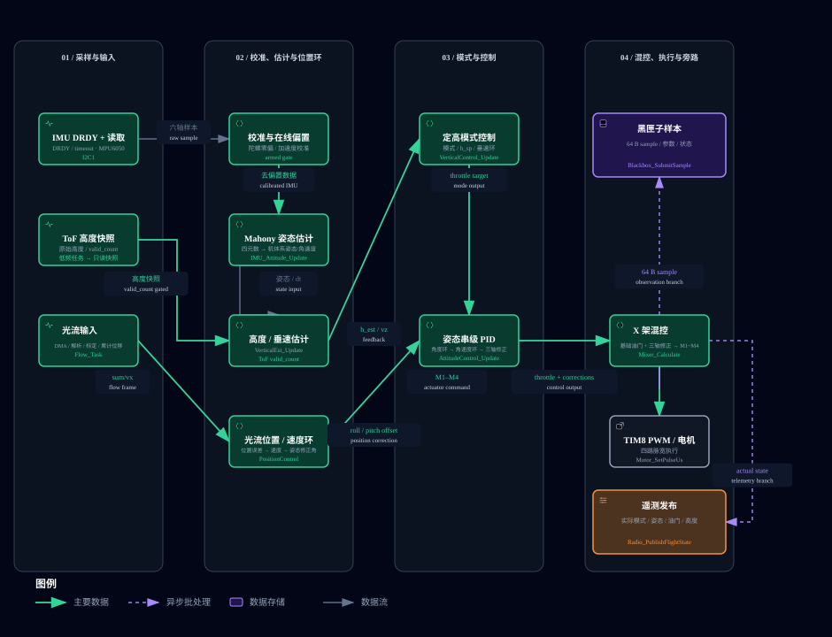
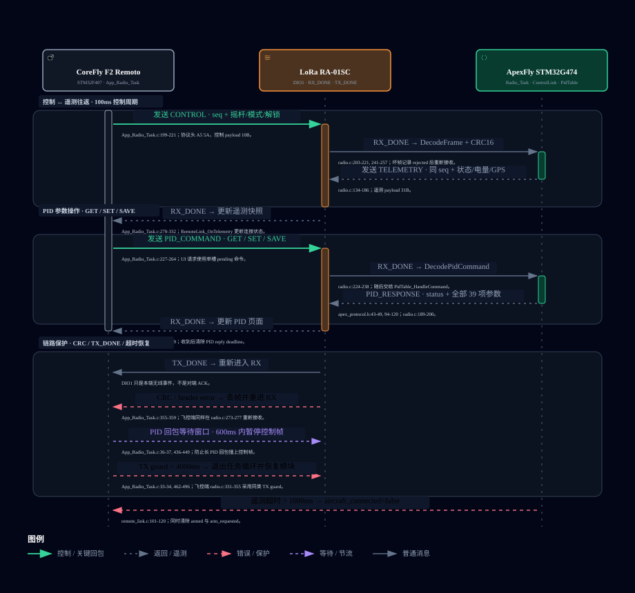
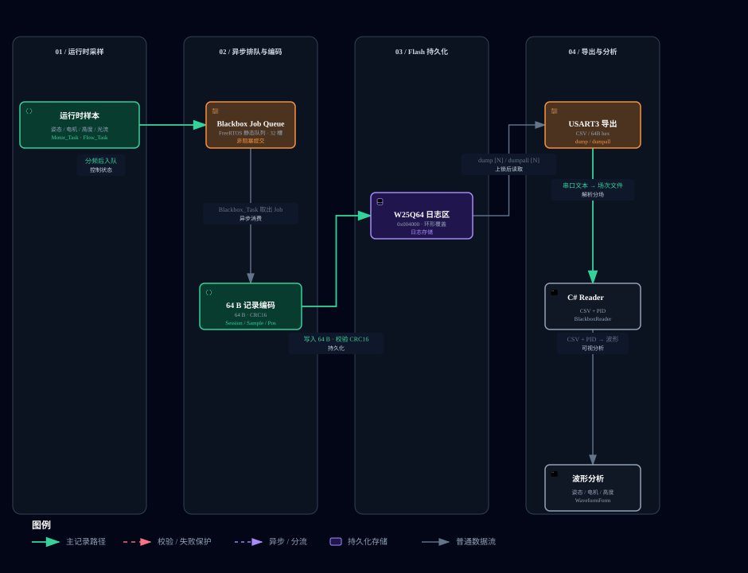

# ApexFly V2.0 架构图

[← 返回工程展示首页](../index.html)

## 系统总体架构

基于 ApexFly V2.0 飞控仓库与 CoreFly F2 Remoto 遥控器仓库的代码核对结果绘制。

- [PNG 静态图](system-architecture.png)
- [SVG 矢量图](system-architecture.svg)
- [交互式 HTML 图](system-architecture.html)

> 交互式 HTML 适合通过 GitHub Pages 打开；GitHub 仓库页面直接显示 SVG/PNG。
> 六张交互图统一为深色外壳，保留 Archify 的节点聚焦、路径、透镜和节点索引；在图上滚动鼠标滚轮可按光标位置缩放（100%–300%）。

## 软件分层架构

展示遥控器与飞控的应用、通信、估计、控制、驱动和系统层边界。

- [PNG 静态图](software-layers.png)
- [SVG 矢量图](software-layers.svg)
- [交互式 HTML 图](software-layers.html)

## 实时控制数据流

展示 IMU/ToF/光流输入、校准与估计、控制环、混控、电机 PWM，以及黑匣子和遥测旁路。

- [PNG 静态图](realtime-control.png)
- [SVG 矢量图](realtime-control.svg)
- [交互式 HTML 图](realtime-control.html)

## 飞行状态机与故障保护

展示上电、上锁待机、解锁门禁、正常飞行，以及 IMU、遥控链路、ToF/高度和定点控制的保护路径。

- [PNG 静态图](lifecycle-flight-safety.png)
- [SVG 矢量图](lifecycle-flight-safety.svg)
- [交互式 HTML 图](lifecycle-flight-safety.html)

## LoRa 通信时序

展示控制帧、遥测回包、PID 参数 GET/SET/SAVE、CRC16、TX_DONE、等待窗口与链路超时保护。

- [PNG 静态图](lora-communication.png)
- [SVG 矢量图](lora-communication.svg)
- [交互式 HTML 图](lora-communication.html)

## 黑匣子与日志数据流

展示运行时样本、FreeRTOS 黑匣子队列、64 B/CRC16 记录、W25Q64 环形日志、USART3 导出和 C# 波形分析链路。

- [PNG 静态图](blackbox-logs.png)
- [SVG 矢量图](blackbox-logs.svg)
- [交互式 HTML 图](blackbox-logs.html)
